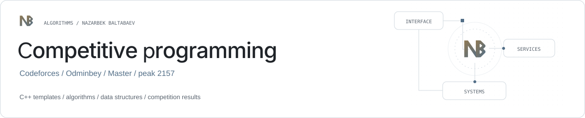

<picture><source media="(prefers-color-scheme: dark)" srcset="assets/banner.svg"></picture>

# Competitive programming

**C++ templates, competition results and olympiad organization.**

[Codeforces: Odminbey](https://codeforces.com/profile/Odminbey) · [KEP.uz](https://kep.uz/) · [Template library](#template-library) · [Profile](https://github.com/archon1999)

C++ reference implementations maintained by [Nazarbek Baltabaev](https://github.com/archon1999), a Codeforces **Master** with a peak rating of **2157**. Competition results and event organization are listed with sources.

## Selected results

| Year / season | Competition | Result |
| --- | --- | --- |
| 2025 | [Yandex Cup — Frontend main category](https://new.contest.yandex.com/contests/86107/leaderboard) | **1st place**, 158 points |
| 2024 | [Yandex Cup — Frontend](https://t.me/yandex_cup/125) | **Finalist** |
| 2019–2020 | [ICPC Uzbekistan & Tajikistan Regional](https://official.contest.yandex.ru/uz2020/contest/23207/standings/) | **1st place, team** — TUIT MathX |
| 2020 | [Education Quality Inspectorate — national online competition](https://t.me/uztdi/1065) | **2nd place, student category**, 7 solved |
| 2020 | [IT Park Cup, Division A](https://www.it-park.uz/ru/itpark/news/godovshchina-one-million-uzbek-coders-i-pobediteli-konkursov-kak-eto-bylo) | **2nd place** |
| 2018–2019 | [ICPC Uzbekistan](https://neerc.ifmo.ru/archive/2019/uzbekistan/standings.html) | **2nd place, team** — Urgench TUIT #1 |
| 2019 | [RoboCoders, youth category](https://www.uzdaily.uz/ru/opredeleny-finalisty-konkursa-robo-coders-2019/) | **1st place** |
| 2017–2018 | [ICPC Uzbekistan Subregional](https://neerc.ifmo.ru/archive/2018/uzbekistan/standings.html) | **1st place, team** — TUIT Urgench Branch #1 |

An unusual highlight: the [Codeforces Round 570 announcement](https://codeforces.com/blog/entry/67938) lists my historical handle `Nazarbek_Baltabaev` first among the round's best hackers, with **120 successful hacks**. That is a hacking result, separate from the overall contest ranking.

ICPC results are regional team placements. Individual competition results identify their category.

## Olympiad organization

| Event | Contribution |
| --- | --- |
| [KEP Junior Algorithmics 2024](https://t.me/KEPuzChannel/1156) | Organization and final problem-set co-authorship; 200+ participants, two qualifiers and a Khorezm final. |
| [REVO CUP 2025](https://revolution.uz/uz/blog/revo-cup-2025-programming-and-cybersecurity-contest) | Co-organized with REVO Global across programming and CTF, with qualifiers on KEP.uz and an offline final in Urgench. |

[Event dates, credits and primary sources](https://github.com/archon1999/engineering-portfolio/blob/main/community/olympiads.md).

## Template library

Standalone C++ reference implementations, grouped for navigation. Review the assumptions and adapt the code to each problem; this repository does not expose a single packaged library or universal build target.

| Area | Files |
| --- | --- |
| Foundations | [Base solution](templates/solution.cpp) · [Bit operations](templates/bitwise.cpp) · [Three-value structure](templates/triple.cpp) |
| Disjoint sets | [DSU](templates/dsu.cpp) |
| Range queries | [Fenwick tree](templates/fenwick.cpp) · [Segment tree](templates/segment_tree.cpp) · [Sparse table](templates/sparce_table.cpp) · [Mo's algorithm](templates/mo.cpp) |
| Trees | [Binary search tree](templates/bst.cpp) · [Lowest common ancestor](templates/lca.cpp) · [Treap](templates/treap_1.cpp) · [Implicit treap](templates/treap_2.cpp) |
| Strings | [String hashing](templates/str_comparator.cpp) · [Suffix array](templates/suffix_array.cpp) · [Aho–Corasick](templates/trie.cpp) · [Trie](templates/trie_bor.cpp) |
| Number theory | [Modular arithmetic](templates/modular.cpp) · [Number theory helpers](templates/number.cpp) · [Factorization](templates/nt.cpp) |
| Sequences | [List](templates/list.cpp) |

## Beyond contests

I founded [KEP.uz](https://kep.uz/), a programming practice and learning platform, and contribute to [cp.uz](https://cp.uz/), an Uzbek-language competitive-programming knowledge platform.

[Telegram](https://t.me/archon1999) · [GitHub](https://github.com/archon1999)

